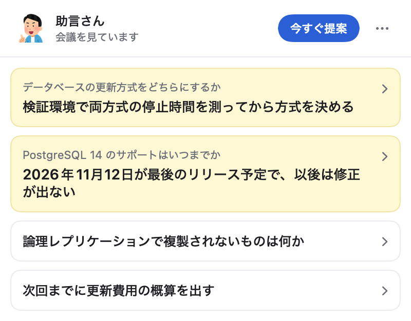

# 助言さん

助言さんは、[文字起こしちゃん](https://github.com/minorun365/live-dictation)の文字起こしを読み、会議中に調査結果と議論の進め方の提案をメニューバーへ出す Mac アプリです。文字起こしちゃんの録音が始まると、すべての会議で自動で動きます。



## 主な機能

発言から、自分が持ち帰ると言った件、相手の質問、話が止まっている論点を見つけてカードにします。調べて答えが出るものは Web で調べ、論点には進め方の提案を付けます。

カードは新しいものが常に一番上に来る1列で並び、未読は薄い黄色で目立ちます。1枚に1つの話題だけを載せ、押すと理由や出典が開きます。

自分の持ち帰りと、確信度の高い相手の質問・論点は押さなくても動きます。自動で動くのは1会議5回までで、残りは候補として並び、押すと調べます。新しい結果が届くとメニューバーのアイコンが変わります。

「今すぐ提案」を押すと、判定の順番を待たずに、その時点までの文字起こしから今やるとよいことを1つ出します。

判定の頻度、自動で動く条件、保存されるファイル、設定は [動作の詳細](docs/behavior.md) にまとめています。

## 動作環境

- macOS 26.4 以降の Apple Silicon Mac
- [文字起こしちゃん](https://github.com/minorun365/live-dictation)
- ログイン済みの [Claude Code](https://code.claude.com/docs)（`claude` コマンド）
- ビルドに Xcode（Swift 6.2 以降）

## セットアップ

Claude Code にリポジトリの URL を渡して頼みます。

```text
https://github.com/minorun365/live-advisor これ入れといて
```

### Claude Code 向けの設定手順

1. このリポジトリを clone します
2. `claude --version` が通ることを確かめます。通らなければ、Claude Code の導入とログインを利用者に案内して止まります
3. `scripts/install.sh` を実行します。テストのあと、`~/Applications/助言さん.app` へ入れて起動します
4. 次回からログイン時に自動で起動します
5. 利用者に、次の録音から自動で動くことと、下の「会議の内容の送り先」を伝えます

## 会議の内容の送り先

録音が始まると確認なしで動きます。使い始める前に、次の送り先を確認してください。

| 内容 | 送り先 |
|---|---|
| 文字起こしの本文 | Claude Code のログイン先 |
| 書き直した検索の問い | Claude の Web 検索と、開いた Web ページ |
| 結果とログ | この Mac の会議フォルダとログフォルダ |

会議の内容を AI へ送ってよいかは、所属組織の規定と会議の参加者に確認してください。止めたい会議では、パネルの「この会議では止める」を押します。

検索の問いは社名や人名を除いて作りますが、モデルの判断なので残ることがあります。送った問いは会議フォルダの `advisor-queries.jsonl` で確かめられます。

## 費用の目安

費用はログイン中の Claude の利用枠に計上されます。次の値は架空の会議で測った1回あたりの額で、1ドル160円で換算しています。

| 処理 | モデル | 1回あたり |
|---|---|---|
| 判定 | Haiku | 約0.1円 |
| 調査 | Opus | 3〜11円 |
| 提案 | Opus | 7〜24円 |

「今すぐ提案」は提案の段と同じモデルを使い、押した回数だけ計上されます。

## 動作確認の状況

架空の会議の通しテストで確認しています。実際の録音での確認と、作者以外の Mac での導入確認はこれからです。

## ライセンス

ソースコードは [Apache License 2.0](LICENSE) です。

アプリとパネルのアイコンはいらすとやのイラストを使っており、[いらすとやの利用規約](https://www.irasutoya.com/p/terms.html)に従います。Apache License 2.0 の対象外です。詳細は [THIRD_PARTY_NOTICES.md](THIRD_PARTY_NOTICES.md) を見てください。
