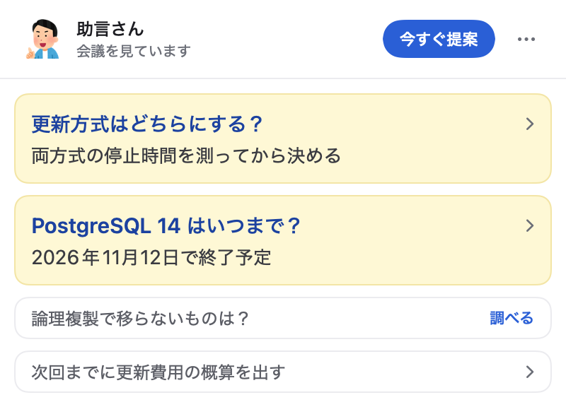

# 助言さん

助言さんは、[文字起こしちゃん](https://github.com/minorun365/live-dictation)の文字起こしを読み取り、会議中に調査結果と議論の進め方の提案をメニューバーに表示する Mac アプリです。文字起こしちゃんの録音が始まると、すべての会議で自動で動きます。



## 主な機能

発言から、自分が持ち帰ると言った件、相手の質問、話が止まっている論点を見つけてカードにします。調査すれば答えが出るものは Web で調べ、論点には進め方の提案を付けます。

カードは新しいものが常に一番上に来るよう1列に並び、未読のカードには黒い点が付きます。1枚につき1つの話題だけを載せ、押すと理由や出典が開きます。

話に出た製品名や制度、料金や期限などの数字は、誰も質問していなくても先に調べておき、答えが分かってからカードにします。新しい結果が出ると、メニューバーのアイコンが変わります。

手元にある案件ごとの議事録やメモのフォルダを設定しておくと、会議の冒頭で同じ相手の過去の記録を探し、前回までの経緯と今日聞くとよいことをカードにします。会議の途中で「前回いくらでしたっけ」のように前の決定や金額が話に出たときも、答えになる記録を探し直します。見つけた経緯は、そのあとの提案にも使います。

「調べてほしい」と思ったら、「今すぐ提案」を押すか、どのアプリを使っているときでも `⌃⌥R` を押します。直近2分の話から調査する項目を選んで Web で調べ、該当するものが無ければ今やるとよいことを1つ提案します。

会議中に「Plannerに登録しときます」のように作業を頼まれたら、「依頼を確認」を押します。直近5分の発言から依頼を抜き出してカードにし、「Claude に渡す」を押すと、Claude デスクトップアプリに依頼文が入った新しいセッションが開きます。読んで送れば、いつもの Claude Code が MCP などを使って作業します。

判定の頻度、自動で動く条件、保存されるファイル、設定は [動作の詳細](docs/behavior.md) にまとめています。

## 動作環境

- macOS 26.4 以降の Apple Silicon Mac
- [文字起こしちゃん](https://github.com/minorun365/live-dictation)。事前に導入が必要で、入っていない間はパネルに導入ページへの案内が出ます
- ログイン済みの [Claude Code](https://code.claude.com/docs)（`claude` コマンド）
- ビルド用の Xcode（Swift 6.2 以降）

## セットアップ

Claude Code にリポジトリの URL を渡して頼みます。

```text
https://github.com/minorun365/live-advisor これ入れといて
```

### Claude Code 向けの設定手順

1. このリポジトリを clone します
2. `claude --version` が通ることを確かめます。通らなければ、Claude Code の導入とログインを利用者に案内して中断します
3. `mdfind "kMDItemCFBundleIdentifier == 'com.minorun365.LiveDictation'"` で文字起こしちゃんを探します。見つからなければ、助言さんだけでは動かないことを利用者に伝え、了承を得てから [文字起こしちゃんの手順](https://github.com/minorun365/live-dictation#インストール) に沿って導入します。初回の「このまま開く」と権限の許可は利用者の操作なので、案内して待ちます
4. `scripts/install.sh` を実行します。テストのあと、`~/Applications/助言さん.app` に配置して起動します
5. 次回からログイン時に自動で起動します
6. 利用者に、次の録音から自動で動くことと、下の「会議の内容の送り先」を伝えます

## 会議の内容の送り先

録音が始まると確認なしで動きます。使い始める前に、次の送り先を確かめてください。

| 内容 | 送り先 |
|---|---|
| 文字起こしの本文 | Claude Code のログイン先 |
| 書き換えた検索クエリ | Claude の Web 検索と、開いた Web ページ |
| 記録フォルダの中身（設定した場合） | Claude Code のログイン先 |
| 結果とログ | この Mac の会議フォルダとログフォルダ |

会議の内容を AI へ送ってよいかは、所属組織の規定と会議の参加者に確認してください。止めたい会議では、パネルの「この会議では止める」を押します。

検索クエリは社名や人名を除いて作りますが、モデルの判断なので残ることがあります。送ったクエリは会議フォルダの `advisor-queries.jsonl` で確かめられます。

## 費用の目安

費用はログイン中の Claude の利用枠に計上されます。次の値は架空の会議で測定した1回あたりの金額で、1ドル160円で換算しています。

| 処理 | モデル | 1回あたり |
|---|---|---|
| 判定 | Haiku | 約0.1円 |
| 調査 | Opus | 3〜11円 |
| 提案 | Opus | 7〜24円 |
| 依頼を確認 | Sonnet | 約2円 |
| 経緯（設定した場合） | Sonnet | 約6円。架空の小さな記録での測定値で、記録が多いほど増えます。途中の探し直しは1会議4回まで |

「今すぐ提案」は調査を最大2回、調べるものが無ければ提案を1回実行し、押した回数分が計上されます。先回りの調査は1会議15件までです。

## 動作確認の状況

架空の会議を使った通しテストで確認しています。実際の録音での検証と、作者以外の Mac への導入テストはこれからです。

## ライセンス

ソースコードは [Apache License 2.0](LICENSE) です。

アプリとパネルのアイコンにはいらすとやのイラストを使っており、[いらすとやの利用規約](https://www.irasutoya.com/p/terms.html)が適用されます。これらは Apache License 2.0 の対象外です。詳細は [THIRD_PARTY_NOTICES.md](THIRD_PARTY_NOTICES.md) を参照してください。
